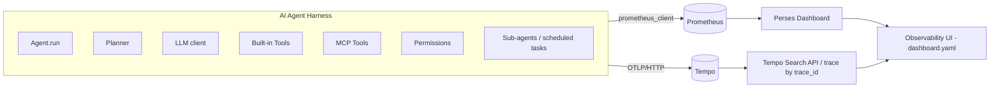

# Observability

This document describes the observability stack for `agent-harness`:
**Prometheus** (metrics), **OpenTelemetry** (tracing instrumentation), **Tempo**
(trace storage), and **Perses** (dashboards). There is no Grafana anywhere in
this stack.

## 1. Architecture



- **Prometheus** scrapes `/metrics` on the agent container (port `8001`), exposed
  by `prometheus_client.start_http_server(8001)` in `main.py` - unchanged from
  before this work.
- **OpenTelemetry** (`Observability/tracing.py`) creates spans around each
  instrumented component and exports them over **OTLP/HTTP** to Tempo.
- **Tempo** stores traces and exposes a search API (and UI) on port `3200`.
- **Perses** (port `8080`) reads only from Prometheus - dashboards-as-code live
  under `deploy/perses/resources/`.

## 2. Prometheus

Unchanged: `prometheus_client.start_http_server(8001)` in `main.py`, metrics
defined in `Observability/metrics.py`, all metric updates funneled through
`Observability/hooks.py` (`ObservabilityHooks`) so business logic never touches
`prometheus_client` directly.

### Existing metrics (reused, not modified)

| Metric | Type | Labels |
|---|---|---|
| `agent_runs_total` | Counter | - |
| `agent_active_runs` | Gauge | - |
| `agent_run_duration_seconds` | Histogram | - |
| `llm_calls_total` | Counter | - |
| `llm_call_duration_seconds` | Histogram | - |
| `llm_input_tokens_total` / `llm_output_tokens_total` | Counter | - |
| `tool_calls_total` / `tool_success_total` / `tool_failure_total` | Counter | `tool_name`, `tool_type` |
| `tool_call_duration_seconds` | Histogram | `tool_name`, `tool_type` |
| `memory_operations_total` | Counter | - |
| `memory_retrieval_duration_seconds` | Histogram | - |
| `permission_decisions_total` | Counter | `tool_name`, `tool_type`, `decision` |

### New metrics (added to fill genuine gaps only)

| Metric | Type | Labels | Why it was missing |
|---|---|---|---|
| `agent_run_failures_total` | Counter | - | No metric distinguished a failed run from a successful one. |
| `planner_duration_seconds` | Histogram | `operation` (`create_plan`/`decompose_task`) | Planner had no latency metric at all. |
| `planner_errors_total` | Counter | `operation` | Planner had no failure metric. |
| `llm_errors_total` | Counter | `component` (`agent`/`planner`/`memory`) | An LLM exception was previously unobserved by any metric. |
| `permission_check_duration_seconds` | Histogram | `tool_name`, `tool_type` | Permission decisions had a counter but no latency. |
| `subagent_runs_total` / `subagent_failures_total` | Counter | `subagent_type` | No metric existed for scheduled-task (sub-agent) executions. |
| `subagent_active_runs` | Gauge | - | Same. |
| `subagent_run_duration_seconds` | Histogram | `subagent_type` | Same. |

`subagent_type` is always the constant `"scheduled_task"` today - the only kind
of sub-agent execution that exists in this codebase (see §9). `run_id` is
**never** a label anywhere, by design (would be unbounded cardinality) - see §5
for how a specific run is still inspectable.

## 3. OpenTelemetry tracing

All tracing setup lives in one place: `Observability/tracing.py`.

- `init_tracing()` - called once, from `main.py`, before `agent.start()`. Reads
  `OTEL_*` env vars (see §7) and installs a `TracerProvider` with a
  `BatchSpanProcessor` exporting via `OTLPSpanExporter` (OTLP/HTTP, not gRPC -
  avoids pulling `grpcio` into the slim Docker image).
- If `OTEL_ENABLED=false`, or setup fails for any reason (unreachable Tempo,
  missing SDK, etc.), `init_tracing()` logs a message and leaves
  OpenTelemetry's built-in global no-op `TracerProvider` in place. Every other
  module still calls `get_tracer()`/`traced_span()` exactly the same way - no
  `if tracing_enabled:` branches anywhere else in the codebase.
- `traced_span(name, attributes={...})` is a context manager used everywhere:
  sets the given attributes, and if an exception propagates out of the `with`
  block, OpenTelemetry's own `record_exception=True`/`set_status_on_exception=True`
  behavior marks the span as `ERROR` and records the exception - **the
  exception itself is never swallowed**, it still propagates to the caller.

### Instrumented components and span names

Only components that exist in this codebase are instrumented:

| Span name | Where | Key attributes |
|---|---|---|
| `agent.run` | `agent/agent.py: Agent.run()` | `run.id`, `agent.name`, `agent.type`, `model.name`, `run.status` |
| `planner` | `agent/agent.py`, around `Planner.create_plan`/`create_task_plan` | `planner.operation` |
| `llm.request` | `agent/agent.py` (main loop), `agent/planner.py` (both calls), `agent/memory.py` (`_summarize_turns`) | `llm.model`, `llm.provider`, `llm.operation`, `llm.input_tokens`, `llm.output_tokens`, `llm.total_tokens`, `llm.duration_seconds` |
| `permission.check` | `harness/harness.py: Harness.execute()` | `permission.resource`, `permission.action`, `permission.decision`, `tool.type` |
| `tool.call` | `harness/harness.py`, local/built-in tool branch | `tool.name`, `tool.type="builtin"`, `tool.status` |
| `mcp.tool.call` | `harness/harness.py`, MCP tool branch | `tool.name`, `tool.type="mcp"`, `mcp.server` (from `MCPManager.tool_servers`), `tool.status` |
| `subagent.run` | `agent/agent.py: Agent.run_scheduled_tasks()` | `subagent.name`, `subagent.type`, `subagent.status` |
| `memory.retrieval` | `agent/memory.py: MemoryManager.get_relevant_memory()` | `memory.operation`, `memory.status` (on error) |

A representative trace tree, for a request that gets decomposed into one
scheduled task that itself calls an MCP tool:

```
agent.run (run_id=abc-123)
├── planner (create_plan)
│   └── llm.request
├── planner (decompose_task)
│   └── llm.request
└── subagent.run (scheduled_task)
    └── agent.run (run_id=def-456)   <- the scheduled task's own run
        ├── planner (create_plan)
        │   └── llm.request
        ├── memory.retrieval
        ├── llm.request
        ├── permission.check
        ├── mcp.tool.call (tavily / notion / email / google_calendar)
        └── llm.request
```

**No cross-process propagation** is used for `subagent.run`: scheduled tasks
run in-process, in the same coroutine chain (`Agent.run_scheduled_tasks()`
directly `await`s `self.run(...)`), not as a separate process - so plain
nested spans (shared context via `contextvars`) are correct and sufficient.
MCP servers, by contrast, genuinely are separate processes/services, but only
the **client-side** `mcp.tool.call` span is emitted (see §9, Known limitations).

### Errors

Every `except Exception` block that already existed (planner's internal
catch-and-fallback, harness's tool/MCP catch, agent's outer catch) now *also*
sets `tool.status`/`run.status`/`subagent.status` to `"error"` and/or calls
`span.record_exception(...)`. In every case the original control flow -
whether that block re-raises or returns a structured `{"success": False, ...}`
- is unchanged.

## 4. Tempo

`deploy/tempo/tempo.yaml` is a minimal single-binary config: OTLP
receivers on `4317` (gRPC) and `4318` (HTTP), local block storage under
`/var/tempo`. No S3/GCS backend - fine for a course project, not meant for
production retention.

## 5. Correlation: run_id -> trace_id -> spans

1. Every `Agent.run()` call generates `run_id = str(uuid.uuid4())` (unchanged
   from before this work) and starts the `agent.run` span with a `run.id`
   attribute set to that same value.
2. `Observability/logging.py` (`StructuredLogger.log()`) now automatically
   reads the *currently active* span's `trace_id`/`span_id` (via
   `Observability.tracing.current_trace_context()`) and includes them, plus
   `service`, `level`, `component`, and `status`, on every JSON log line -
   alongside the `run_id` that was already there. Example line:

   ```json
   {"timestamp": "...", "level": "INFO", "service": "agent-harness",
    "event": "tool_finish", "run_id": "abc-123",
    "trace_id": "908fa11e6d6fab5c40d9ddaf9c63a7fc",
    "span_id": "ea5dd67486359e30", "component": null, "status": null,
    "Tool_name": "list_files", "Tool_type": "Local", "Result": true}
   ```

3. To inspect one specific run: find its `run_id` (printed by the CLI, or in
   your own logs), `grep` the agent's stdout JSON logs for that `run_id`, read
   off any `trace_id` from a matching line, then look that `trace_id` up in
   Tempo (§8). `run_id` is deliberately **not** a Prometheus label (would be
   unbounded cardinality) - Prometheus tells you *something is slow/failing*,
   the `run_id -> trace_id` correlation tells you *which exact run* and lets
   you see every span in it.

## 6. Perses dashboard

Dashboard-as-code lives under `deploy/perses/`:

- `config.yaml` - standalone Perses server config: file-based DB +
  folder-based provisioning from `resources/`.
- `resources/project.yaml` - the `agent-harness` Perses project.
- `resources/datasource.yaml` - a `Prometheus` datasource, **proxy mode**
  (`http://prometheus:9090`, reached from the Perses *backend* inside the
  compose network - not `directUrl`, which would require the *browser* to
  resolve that hostname).
- `resources/dashboard.yaml` - **"AI Agent Observability"**, 19 panels across
  6 sections, every panel a `TimeSeriesChart` (see "Known limitations" below
  for why).

### Panel list (all PromQL, panel kind `TimeSeriesChart`)

**Section 1 - Run Overview**
1. Active Runs - `agent_active_runs`
2. Agent Throughput - `rate(agent_runs_total[5m])`
3. Success Rate - `1 - (rate(agent_run_failures_total[5m]) / rate(agent_runs_total[5m]))`
4. Failure Rate - `rate(agent_run_failures_total[5m]) / rate(agent_runs_total[5m])`

**Section 2 - Latency**
5. Agent Run Latency (P50/P95/P99) - `histogram_quantile(0.50|0.95|0.99, sum(rate(agent_run_duration_seconds_bucket[5m])) by (le))`
6. Component Latency (P95, one line each) - agent/planner/llm/tool(builtin)/mcp/permission/sub-agent, each `histogram_quantile(0.95, sum(rate(<metric>_bucket{...})) by (le))`

**Section 3 - LLM Usage**
7. LLM Token Usage - `rate(llm_input_tokens_total[5m])`, `rate(llm_output_tokens_total[5m])`, sum of both
8. LLM Request Rate - `rate(llm_calls_total[5m])`
9. LLM Latency (P95) - `histogram_quantile(0.95, sum(rate(llm_call_duration_seconds_bucket[5m])) by (le))`
10. LLM Errors - `sum(rate(llm_errors_total[5m])) by (component)`

**Section 4 - Tool Usage**
11. Tool Usage Rate by Type - `sum(rate(tool_calls_total[5m])) by (tool_type)`
12. Most Frequently Used Tools - `topk(10, sum(increase(tool_calls_total[1h])) by (tool_name))`
13. Tool Failures - `sum(rate(tool_failure_total[5m])) by (tool_name)`

**Section 5 - Permissions**
14. Permission Decisions - `sum(rate(permission_decisions_total[5m])) by (decision)`
15. Permission Check Latency (P95) - `histogram_quantile(0.95, sum(rate(permission_check_duration_seconds_bucket[5m])) by (le))`

**Section 6 - Sub-agents**
16. Sub-agent Execution Rate - `sum(rate(subagent_runs_total[5m])) by (subagent_type)`
17. Active Sub-agents - `subagent_active_runs`
18. Sub-agent Failures - `sum(rate(subagent_failures_total[5m])) by (subagent_type)`
19. Sub-agent Latency (P95) - `histogram_quantile(0.95, sum(rate(subagent_run_duration_seconds_bucket[5m])) by (le))`

## 7. Configuration (environment variables)

All new variables are optional and default to safe, tracing-enabled-but-inert
behavior. See `.env.example` for the full, current list alongside the
pre-existing `INNKUBE_*`/`TAVILY_API_KEY`/`GOOGLE_*`/`HF_TOKEN` vars.

| Variable | Default | Purpose |
|---|---|---|
| `OTEL_ENABLED` | `true` | Master switch; `false` fully disables tracing (no spans, zero exporter overhead). |
| `OTEL_SERVICE_NAME` | `agent-harness` | `service.name` resource attribute + `service` field in JSON logs. |
| `OTEL_ENVIRONMENT` | `development` | `deployment.environment` resource attribute. |
| `OTEL_EXPORTER_OTLP_ENDPOINT` | *(empty)* | Base OTLP/HTTP endpoint (`/v1/traces` appended automatically). Empty = spans are created but not exported. `docker-compose.yml` sets this to `http://tempo:4318` for the `agent` service - **never hardcoded in application code**. |
| `OTEL_EXPORTER_OTLP_PROTOCOL` | `http/protobuf` | Recorded for documentation/consistency; the exporter used is always OTLP/HTTP. |

## 8. Docker Compose

`docker-compose.yml` adds four services around the existing `Dockerfile`
(unchanged): `prometheus`, `tempo`, `perses` (plus a one-shot `perses-init`
helper, see §8.2), all on one `observability` network, plus named volumes
(`prometheus_data`, `tempo_data`, `perses_data`) for persistence across
restarts. `prometheus/prometheus.yml`'s scrape target was changed from
`host.docker.internal:8001` to `agent:8001` - the only edit to existing
observability config, needed because the agent now runs as a compose service
on the same network (`host.docker.internal` isn't reliable on Linux Docker
hosts without extra configuration; a compose service name is the idiomatic,
reliable choice).

### 8.1 Perses startup issues found and fixed while verifying this stack

Getting `persesdev/perses:v0.50.1` running cleanly took two real fixes,
found by actually running the stack (not guessed):

1. **`unable to initialize the service manager: open schemas/panels: no such
   file or directory`** - Perses' CUE panel/query/datasource schemas are
   baked into the image at `/etc/perses/cue/schemas/` (see its upstream
   `Dockerfile`), and only the image's *own default* config
   (`/etc/perses/config.yaml`) points there. Supplying a custom
   `config.yaml` (needed for file-based provisioning) resets the schema
   paths to their relative defaults (`schemas/panels`, resolved against the
   image's `WORKDIR /perses`), which don't exist there. Fixed by adding an
   explicit `schemas:` block to `deploy/perses/config.yaml` pointing at the
   real baked-in paths. (That config section is marked deprecated upstream
   and may not be needed in a future Perses version.)
2. **`mkdir /perses/data/dashboards: permission denied`** (and the same for
   `datasources`/`projects`) - the image runs as the non-root `nobody` user
   (uid 65534) for security, but a fresh Docker named volume is created
   root-owned, so Perses couldn't create subdirectories in it on first
   start. Fixed with a `perses-init` service: a `busybox` container that
   `chown`s the `perses_data` volume to uid 65534 before `perses` starts
   (`depends_on: perses-init: condition: service_completed_successfully`).

Both are now verified fixed: `docker compose up` provisions the
`agent-harness` project, `prometheus` datasource, and `ai-agent-observability`
dashboard successfully every time (confirmed via
`GET /api/v1/projects/agent-harness/dashboards`), and a query proxied through
Perses to Prometheus (`POST /proxy/projects/agent-harness/datasources/prometheus/api/v1/query`)
returns real data.

### Running the stack

```powershell
docker compose up --build
```

Ports: agent metrics `:8001`, Prometheus UI `:9090`, Tempo API `:3200`,
Perses UI `:8080`.

### 8.2 Health checks

- `agent`: `python -c "urllib.request.urlopen('http://localhost:8001/metrics')"` (no extra tooling required, same interpreter the app runs on). Verified: reports `healthy`.
- `prometheus`: `wget` against `/-/healthy` (present in the official image). Verified: reports `healthy`.
- `tempo`: `wget` against `/ready` (present in the official image). Verified: reports `healthy`.
- `perses`: **no Docker healthcheck** - verified `persesdev/perses:v0.50.1` is
  fully distroless (`docker run --entrypoint sh ... `: *"sh: executable file
  not found"*; same for `wget`), so no command can be exec'd inside the
  container to probe it at all. Nothing `depends_on` Perses's health, so this
  has no functional effect. Verify readiness from the host instead:
  `curl http://localhost:8080/api/v1/health` (see §10.2).

## 9. Known limitations

- **MCP server-side tracing**: only the client-side `mcp.tool.call` span is
  created. Three of the four MCP servers (Tavily, Notion, Google Calendar) are
  third-party; the fourth (`mcp_servers/email_server.py`) is a separate
  uvicorn process we do own but did not instrument in this change - there is
  no W3C trace-context propagation into any MCP server.
- **"Sub-agents"**: this codebase has no standalone sub-agent class/process -
  `subagent.run` traces the only thing that matches that description, a
  scheduled task re-entering `Agent.run()` in-process via
  `agent/task_scheduler/scheduler.py` + `Agent.run_scheduled_tasks()`.
- **Perses panel schema**: every panel uses `plugin.kind: TimeSeriesChart`.
  The dashboard/datasource/project provision successfully and a query proxied
  through Perses to Prometheus returns real data (verified, see §8.1) -
  `StatChart`/`BarChart`/`Table` would look better for some panels (e.g.
  Active Runs as a single number, Permission Decisions as a donut) but their
  exact `plugin.spec` schema wasn't verified against a live instance; swap
  them in if desired.
- **`PermissionsDec.COONFIRM`**: pre-existing typo (should read "CONFIRM"),
  left as-is - unrelated to this task, and renaming it would touch call sites
  across `harness.py`/tests that weren't part of this change.
- **Live verification**: the full stack (`docker compose up --build`) was
  run end-to-end in this environment - all four services (`agent`,
  `prometheus`, `tempo`, `perses`) confirmed up, Prometheus scraping the agent
  successfully, and Perses' `agent-harness` project/datasource/dashboard
  provisioned and queryable. Two real Perses startup bugs were found and
  fixed in the process (§8.1) - this is not a "should work" claim, it was
  actually exercised.

## 10. How to verify

### 10.1 Without Docker (already done, see the accompanying implementation report)

```powershell
# From agent-harness/, using the project venv:
python tests/run_tests.py          # full suite, incl. tests/test_tracing.py
```

### 10.2 With Docker

```powershell
docker compose up --build
```

**Prometheus metrics:**
- Open http://localhost:9090/targets - the `agent-harness` job should be `UP`.
- Open http://localhost:9090/graph, query `agent_runs_total` - returns a
  series with value `0` even before any request (the metric exists as soon
  as the agent process starts), and increments once you've sent a request.

**Perses dashboard:**
- Open http://localhost:8080, select the `agent-harness` project, open
  "AI Agent Observability". Panels should populate once Prometheus has scraped
  at least one interval (5s) after the agent has handled a request.
- To sanity-check provisioning from the command line instead (what was
  actually run to verify this stack):
  ```powershell
  curl http://localhost:8080/api/v1/projects
  curl http://localhost:8080/api/v1/projects/agent-harness/datasources
  curl http://localhost:8080/api/v1/projects/agent-harness/dashboards
  # exercises the actual Prometheus proxy path the dashboard's panels use:
  curl -X POST "http://localhost:8080/proxy/projects/agent-harness/datasources/prometheus/api/v1/query" --data-urlencode "query=agent_runs_total"
  ```

**Tempo traces:**
- Send a request to the agent (attach to the `agent` container:
  `docker attach agent-harness-agent-1`, or `docker compose run agent`, then
  type a task at the `You:` prompt).
- Note the printed structured log lines for `trace_id`.
- Query Tempo's search API directly (no Grafana needed):
  ```powershell
  curl "http://localhost:3200/api/search?tags=service.name%3Dagent-harness&limit=5"
  curl "http://localhost:3200/api/traces/<trace_id>"
  ```
  The second call returns the full span tree for that one run - this is the
  "individual run inspection" path end to end: `run_id` (from stdout logs) ->
  `trace_id` (same log line) -> full trace (Tempo API).

### 10.3 Troubleshooting

| Symptom | Likely cause |
|---|---|
| Prometheus target `DOWN` | Agent container not healthy yet, or `agent:8001` unreachable - check `docker compose logs agent`. |
| No traces in Tempo | `OTEL_ENABLED=false` or `OTEL_EXPORTER_OTLP_ENDPOINT` unset/wrong - check agent startup log for `[TRACING] Exporting traces via OTLP/HTTP to ...`. |
| Perses dashboard empty/panels error | Datasource proxy can't reach `prometheus:9090` - check `docker compose logs perses`; confirm the `agent-harness` project/datasource were provisioned (Perses UI -> Projects). |
| Perses shows "unhealthy" | See §8 - likely a shell-less base image; harmless, nothing depends on it. |
